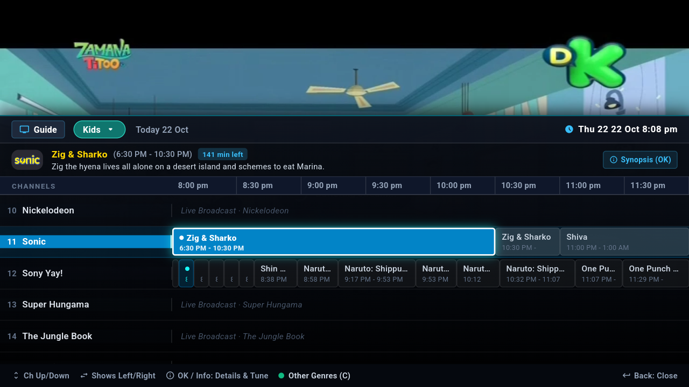
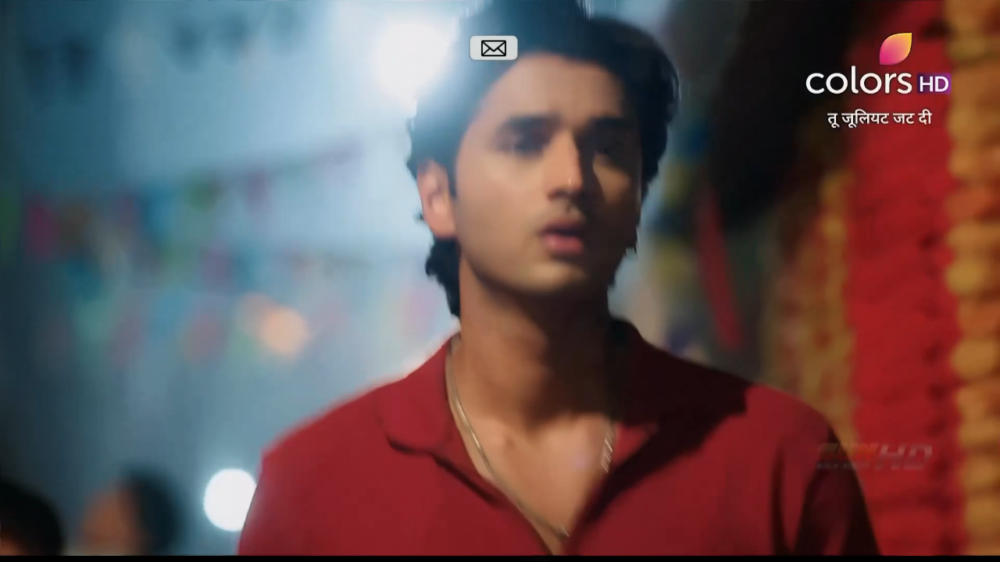

# Open DTH Android IPTV

<h3 align="center">A Native, Ultra-Fast Live TV & DTH Player for Android TV & Google TV</h3>

<p align="center">
  <a href="LICENSE"></a>
  <a href="https://github.com/MandipKumarKanu/open-dth-android-iptv"></a>
  
  
  <a href="https://github.com/MandipKumarKanu"></a>
</p>

---

**Open DTH Android IPTV** is a lightweight, hardware-accelerated TV application designed specifically for Android TV and Google TV sets. Built with Flutter and Google's Media3 ExoPlayer, it delivers a classic Indian Set-Top-Box (STB) experience (matching Tata Play and Airtel Digital TV) over Wi-Fi — with zero subscriptions, zero ads, and zero bloat.

| | |
|---|---|
|  |  |
| *1,100+ Live Channels categorized with Voice Search & Language Filter* | *Classic 4-Hour Timeline EPG with Program Synopsis & PIP Video* |
|  |  |
| *Full HD Live Playback with Multi-Audio & Fit Controls* | *DTH Program Guide with instant D-pad Genre Switching* |

---

## Key Features

### 1. 1,100+ Curated Live Channels
- **Categorized Sidebar**: Browse News, Entertainment, Movies, Sports, Music, Kids, Infotainment, Business, and Devotional channels with live channel counters.
- **Language Filtering**: Instantly isolate channels by regional languages (Hindi, English, Tamil, Telugu, Kannada, Malayalam, Bengali, Marathi, Punjabi, Gujarati, etc.).
- **Favorites & History**: Bookmark preferred channels with a single click and access automated recently-watched shelves.
- **Voice & Text Search**: Dedicated search dialog with Android TV remote microphone voice recognition.

### 2. DTH-Style 4-Hour Timeline EPG (Program Guide)
- **Classic STB Grid**: Modeled directly after Tata Play and Airtel DTH interfaces with horizontal 30-minute time slots (e.g., 8:00 PM, 8:30 PM, 9:00 PM).
- **Background PIP Playback**: Video playback continues seamlessly in the background while browsing the guide.
- **Show Synopsis & Reminders**: Select any upcoming show to read synopsis, cast information, and set on-screen alert notifications.
- **100% D-Pad Remote Navigable**:
  - Press **Up (⬆️)** in the guide to focus the category pill.
  - Cycle genres with **Left / Right (⬅️/➡️)**.
  - Press **OK** or **Menu (☰)** to open a clean **Category Picker Modal Dialog**.
  - Fast-scroll large channel lists with **Channel Up / Channel Down (Page Up / Page Down)**.

### 3. Media3 ExoPlayer & Multi-Audio
- **Multi-Audio Track Selection**: Channels broadcasting multiple language audio tracks (*English, Hindi, Spanish, Tamil, German, Japanese, etc.*) automatically display an amber **Audio (🔊)** switcher in the player control bar.
- **Hardware Acceleration**: ExoPlayer Media3 hardware-accelerated playback with HEVC, H.264, and AAC decoding.
- **18-Second Live Buffer Safety Window**: Automatically establishes a jitter safety window behind the live broadcast edge to prevent buffering stutters on home Wi-Fi networks.
- **Auto-Fallback & Reconnect**: Automatically tries backup stream sources on temporary network drops without interrupting the user.

### 4. TV Remote Ergonomics & Performance
- **Aspect Ratio Control**: One-click screen fit toggle (*Fit, Fill, Zoom, 16:9 stretch*).
- **Last Channel Recall**: Quick button to immediately flip back to the previous channel.
- **60 FPS on 1 GB RAM Smart TVs**: Offstage category grid caching, disk-cached logos, and zero frame-dropping animation overhead.

---

## Build & Installation

### Prerequisites
- Flutter SDK (3.x+)
- Android SDK & JDK 17
- Android TV / Google TV device with USB/Network Debugging enabled

### 1. Build APK

```bash
# Clone the repository
git clone https://github.com/MandipKumarKanu/open-dth-android-iptv.git
cd open-dth-android-iptv

# Fetch dependencies
flutter pub get

# Build APK (for 32-bit ARM smart TVs - most common):
flutter build apk --release --target-platform android-arm --android-skip-build-dependency-validation

# Or for 64-bit ARM TVs:
flutter build apk --release --target-platform android-arm64 --android-skip-build-dependency-validation
```

### 2. Install on TV via ADB

```bash
# Connect to your TV over Wi-Fi
adb connect <TV-IP-ADDRESS>:5555

# Install the APK
adb install -r build/app/outputs/flutter-apk/app-release.apk
```

---

## Remote Control Cheatsheet

| Remote Key | Action in Live TV Player |
|---|---|
| **OK / Enter** | Toggle player controls / Open channel mini-guide |
| **Up / Down** | Previous / Next channel |
| **Left / Right** | Cycle audio languages / Seek buffer |
| **Menu (☰)** | Open DTH 4-Hour Timeline Guide (EPG) |
| **Back** | Dismiss current overlay / Return to channel list |
| **Channel +/-** | Page Up / Page Down through channel lists |

---

## Author & Maintainer

Maintained and developed by **Mandip Kumar Kanu**:
- **GitHub**: [@MandipKumarKanu](https://github.com/MandipKumarKanu)
- **Email**: [mandipshah3@gmail.com](mailto:mandipshah3@gmail.com)

---

## License

This project is licensed under the **MIT License** — see the [LICENSE](LICENSE) file for details.
